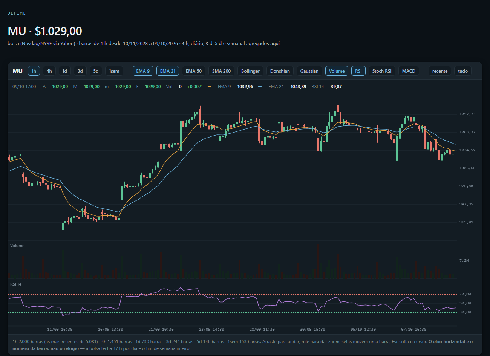

# defime

[](https://github.com/leandrosmoreira53/defime/actions/workflows/tests.yml)
  

**DeFi analytics engine for Uniswap V3/V4 liquidity on Robinhood Chain** — where tokenized stocks and ETFs
(RWA) trade against USDG. It indexes pool events straight from the chain, rebuilds liquidity, prices and
positions from those events, computes the fee that **actually reaches LPs**, ranks RWA pools in a heatmap, and
renders static dashboard pages.

This is the open-source core of the **defime dashboard**, a private, login-protected panel fed by ~30
scheduled collectors on a VPS. Dashboard pages and anything tied to a specific wallet stay private; this repo
is the reusable engine underneath. Companion project: [mcp-defime](https://github.com/leandrosmoreira53/mcp-defime),
an MCP server that exposes pool data to AI agents.

## What's inside

| Layer | Modules | What it does |
|---|---|---|
| **Chain** | `chain/rpc.py`, `multicall.py`, `abi.py`, `abi_v4.py`, `livro_estado.py` | JSON-RPC client with rate limiting and DoH DNS bypass; Multicall3 (many `eth_call`s pinned to one block); V3 pool and V4 `PoolManager` event decoding; liquidity book read from on-chain **state** |
| **Ingest** | `ingest/indexer.py`, `indexer_v4.py`, `blockscout.py`, `npm_link.py` | Idempotent, resumable V3/V4 log indexers with confirmations and chunked block ranges; Blockscout REST fallback when the RPC chokes; links pool events to position NFTs through transaction receipts |
| **Storage** | `db/models.py`, `session.py`, `registro.py` | SQLAlchemy 2 models (SQLite locally, Postgres by changing a URL); append-only series writers |
| **Math & analytics** | `core/v3math.py`, `taxa_lp.py`, `composicao.py`, `book.py`, `prices.py`, `positions.py`, `competitors.py`, `consensus.py`, `fee_density.py`, `fee_model.py`, `migration.py`, `vigilancia.py`, `instante.py`, `sessoes.py` | Integer/Decimal Uniswap V3 math; the LP share of the swap fee read from `slot0.feeProtocol`; range composer (how much of each token to hold before opening a range); liquidity distribution, price series and **every position** rebuilt from events; where fees are actually paid per tick range; where liquidity is migrating; a position's share of a tick's fees vs. its neighbours; a guard against mixing data from different instants; US market sessions for tokenized stocks |
| **RWA heatmap** | `heat_pools.py`, `heatmap.py` | Pure functions (no DB, no network) that rank RWA pools by APR, volume, turnover and "heat", and lay them out as a treemap |
| **News** | `macro/news.py`, `noticias_ativos.py`, `noticias_banco.py` | Per-asset headlines from a provider ladder (Yahoo search and RSS, Google News, optional Alpha Vantage), with topic profiles and alert tags |
| **Costs & market** | `custo/gas.py`, `macro/indicadores.py`, `tecnica.py`, `resumo_tecnico.py`, `acoes.py`, `opcoes.py` | Gas cost model for the chain; RSI, Stoch RSI, MACD, moving averages and channels; range-sizing technicals (volatility, not direction); exchange quote vs. pool price; implied volatility from the options chain |

## Dashboard pages

| Page | Jobs | What it shows |
|---|---|---|
| `/grafico/` | `defime.jobs.acoes` → `defime.jobs.noticias` → `defime.jobs.grafico` | Exchange candles for tokenized stocks (1h collected; 4h, 1d, 3d, 5d and weekly aggregated per trading session), EMA/SMA, Bollinger, Donchian, Gaussian channel, RSI, Stoch RSI, MACD and volume, with the asset's latest headlines |



```bash
python -m defime.jobs.acoes --simbolos MU,PLTR       # Yahoo OHLC → SQLite (acoes_ohlc), ~2 s per symbol
python -m defime.jobs.noticias --simbolos MU,PLTR    # headlines → SQLite
python -m defime.jobs.grafico --simbolos MU,PLTR --saida site   # static HTML in ./site
```

The page is a single static HTML file (data inlined as JSON, chart drawn client-side): serve `site/` with any
web server or open it directly. Schedule the three jobs with cron or systemd timers.

## Design principles

- **Read, don't assume.** Fee protocol, decimals and liquidity come from the contract. On this chain, V3 pools
  with `feeProtocol = 0x66` deliver **5/6** of the nominal fee to LPs; `taxa_lp.py` is tested against the
  `slot0` of 29 real pools ([`tests/fixtures/fee_protocol_v3.json`](tests/fixtures/fee_protocol_v3.json)).
- **Integers in the math, floats only for display.** `v3math.py` works in `int` and high-precision `Decimal`.
- **Same instant or nothing.** `instante.py` refuses to combine readings taken at different blocks or times —
  the most frequent source of wrong numbers in on-chain analytics.
- **Read-only.** No private keys, no signing, no transactions.
- **Measured limits.** The RPC rate limits, chunk size and confirmation depth in
  [`config.py`](src/defime/config.py) were measured against the public RPC; the comments explain how.

## Quick start

```bash
git clone https://github.com/leandrosmoreira53/defime && cd defime
python -m venv .venv && source .venv/bin/activate   # Windows: .venv\Scripts\activate
pip install -e ".[dev]"
pytest                                              # 395 tests, offline
```

```python
from defime.core.taxa_lp import fracao_lp_v3
from defime.core.v3math import tick_to_sqrt_price_x96, amounts_for_liquidity

fracao_lp_v3(0x66)                       # 0.8333… → LPs receive 5/6 of the swap fee

sp, lo, hi = (tick_to_sqrt_price_x96(t) for t in (0, -600, 600))
amounts_for_liquidity(sp, lo, hi, 10**18)  # (29553010879137169, 29553010879137169) in token units
```

Configuration comes from environment variables or a `.env` file (see [.env.example](.env.example)): RPC URL,
chain id, Blockscout URL, the pool to index, indexer limits and the database URL. The default pool is the
public USO/USDG 0.30% pool on Robinhood Chain, and `WALLET` is empty (market data only).

## Tests

395 offline tests — no network, temporary SQLite where a database is needed. They cover V3/V4 ABI decoding,
the indexer against a fake RPC, the Blockscout fallback, NFT linking, liquidity-book integrity, Uniswap V3
math, the LP fee share against 29 real pools, range composition against real on-chain positions, the
heatmap ranking and layout, technical indicators, gas costs, market sessions, the series writers, the news ladder
(recorded Yahoo, Google News, RSS and Alpha Vantage responses) and the `/grafico/` page.

## Status

Opening the private project in phases: the engine (phase 1) and the `/grafico/` page with its collectors
(phase 2) are here; the pools and heatmap pages come next. Code comments are in Portuguese.

## License

[MIT](LICENSE) © 2026 Leandro Moreira · [leandrosmoreira.dev](https://leandrosmoreira.dev)
